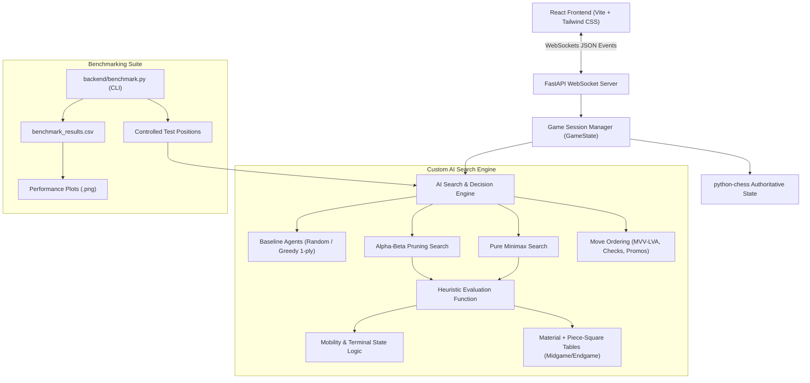

# Real-Time Human vs AI Chess Web Application
### A Full-Stack Self-Learning Project in Adversarial Search & Heuristic Engine Design
**Depth-Limited Minimax • Alpha-Beta Pruning • Move Ordering Heuristics • Real-Time WebSockets**

---

## 1. Project Overview & Motivation

This project is a complete, full-stack adversarial chess web application developed as an **independent self-learning engineering project** into classical Artificial Intelligence, heuristic game playing, and real-time full-stack architectures. It pairs a human player against a custom, handcrafted Python AI engine.

Unlike projects that rely on Stockfish, ready-made chess engines, or hosted LLM APIs, **all search algorithms, pruning heuristics, position evaluation mathematics, and move ordering routines were designed and implemented from scratch**. The `python-chess` library is utilized strictly for low-level board representation, legal move generation, and rule validation.

### Key Highlights
- **Custom Adversarial AI Engine:** Built using depth-limited Minimax and optimized with Alpha-Beta Pruning.
- **Empirical Mathematical Equivalence:** Proves that Alpha-Beta pruning produces identical evaluation scores to pure Minimax while dramatically reducing the search space.
- **Modular Evaluation Function:** Centipawn material balance combined with PeSTO Piece-Square Tables (PST) adapted for midgame and endgame, piece mobility bonuses, and terminal state scoring.
- **Move Ordering Optimization:** MVV-LVA (Most Valuable Victim - Least Valuable Attacker) capture prioritization, check generation, and promotion ordering to maximize $\beta$-cutoffs.
- **Modern Interactive Interface:** Responsive React 19 + Tailwind CSS frontend with SVG pieces, interactive move indicators, captured pieces HUD, and live AI search telemetry.
- **Real-Time WebSockets:** Server-authoritative state management and non-blocking asynchronous search execution.

---

## 2. System Architecture



---

## 3. Technology Stack

| Layer | Technology | Purpose |
|---|---|---|
| **AI Engine** | Custom Python 3.11 Algorithms | Depth-limited Minimax, Alpha-Beta Pruning, Move Ordering, Heuristics |
| **Chess Rules & State** | `python-chess` (v1.11+) | Legal move generation, board representation, special moves, FEN/SAN |
| **Backend API** | FastAPI + Uvicorn | Asynchronous REST endpoints & persistent WebSocket server |
| **Real-Time Transport** | WebSockets (`websockets`) | Low-latency bi-directional move streaming and search telemetry |
| **Frontend UI** | React 19 + Tailwind CSS + Vite | Interactive SVG chessboard, legal move indicators, HUD, settings |
| **Benchmarking & Analysis** | Pandas, NumPy, Matplotlib | Quantitative metric collection and publication-quality plots |
| **Testing Suite** | Pytest (23 unit & integration tests) | Comprehensive verification of chess rules, AI math, and protocols |
| **Deployment** | Render / Docker / Uvicorn | Single-service unified cloud deployment |

---

## 4. Algorithmic Formulations

### A. The Minimax Algorithm
Minimax models chess as a two-player, zero-sum, perfect-information game. White seeks to maximize the evaluation score $V(s)$, while Black seeks to minimize it:

$$V(s) = \begin{cases} 
\text{Eval}(s) & \text{if } \text{IsTerminal}(s) \lor \text{depth} = 0 \\
\max_{a \in \text{Actions}(s)} V(\text{Result}(s, a)) & \text{if } \text{Turn}(s) = \text{White} \\
\min_{a \in \text{Actions}(s)} V(\text{Result}(s, a)) & \text{if } \text{Turn}(s) = \text{Black}
\end{cases}$$

### B. Alpha-Beta Pruning
Alpha-Beta pruning maintains two bounds during depth-first traversal:
- $\alpha$: The highest score the maximizing player is guaranteed so far.
- $\beta$: The lowest score the minimizing player is guaranteed so far.

Whenever $\beta \le \alpha$, the remaining sibling moves cannot affect the final minimax decision and are pruned (cutoff):
- **Maximizing node:** If $v > \alpha$, set $\alpha = v$. If $\beta \le \alpha$, trigger a **Beta cutoff**.
- **Minimizing node:** If $v < \beta$, set $\beta = v$. If $\beta \le \alpha$, trigger an **Alpha cutoff**.

### C. Heuristic Evaluation Function
Evaluations are computed in centipawns ($100\text{ cp} = 1\text{ pawn}$) from White's perspective:

$$\text{Eval}(s) = \sum \text{Material} + \sum \text{PieceSquareTable} + \text{MobilityBonus} + \text{TerminalBonus}$$

- **Material Values:** $P = 100, N = 320, B = 330, R = 500, Q = 900, K = 20,000$.
- **Piece-Square Tables (PST):** Position-dependent tables rewarding centralization, development, open files for rooks, and king safety in the midgame vs. active king centralization in the endgame.
- **Mobility:** $2\text{ cp}$ per legal move available to the active player.
- **Terminal States:** Checkmate $= +100,000 - \text{ply}$ (White win) or $-100,000 + \text{ply}$ (Black win); Stalemate / Draws $= 0\text{ cp}$.

### D. Move Ordering Heuristics
Alpha-Beta efficiency depends heavily on exploring optimal moves early. Moves are ordered by:
1. **Captures (MVV-LVA):** $\text{Priority} = 10,000 + 10 \times \text{VictimValue} - \text{AttackerValue}$.
2. **Promotions:** $+8,000 + \text{PromotedPieceValue}$.
3. **Checks:** $+5,000$ if the move delivers check.
4. **Positional Delta:** Net improvement in Piece-Square Table value.

---

## 5. Experimental Benchmark Results

Controlled experiments were executed across 4 distinct board scenarios:
1. **Opening:** Standard starting chess position.
2. **Middlegame Tactical:** Giuoco Piano tactical position with open diagonals and pin opportunities.
3. **Middlegame Positional:** Sicilian Dragon structure with complex pawn formations.
4. **Endgame:** King + Rook vs. King + Pawns.

### Empirical Measurements (Depth 3)

| Position | Algorithm | Runtime (ms) | Nodes Expanded | Leaf Evaluations | Pruned Branches | Best Move | Eval (cp) |
|---|---|---|---|---|---|---|---|
| **Opening** | Minimax | 1,157.81 | 421 | 8,902 | 0 | `g1f3` | +4 |
| **Opening** | Alpha-Beta | 112.25 | 99 | 801 | 65 | `g1f3` | +4 |
| **Opening** | Alpha-Beta (Ordered) | 75.02 | 62 | 508 | 38 | `g1f3` | +4 |
| **Tactical** | Minimax | 7,089.63 | 1,368 | 48,378 | 0 | `b1c3` | +24 |
| **Tactical** | Alpha-Beta | 1,060.66 | 799 | 6,867 | 658 | `b1c3` | +24 |
| **Tactical** | Alpha-Beta (Ordered) | 440.69 | 213 | 2,487 | 106 | `b1c3` | +24 |
| **Positional** | Minimax | 9,478.22 | 1,611 | 67,951 | 0 | `d4c6` | +84 |
| **Positional** | Alpha-Beta | 1,819.51 | 886 | 13,231 | 608 | `d4c6` | +84 |
| **Positional** | Alpha-Beta (Ordered) | 358.07 | 125 | 1,872 | 74 | `d4c6` | +84 |
| **Endgame** | Minimax | 170.50 | 113 | 1,909 | 0 | `e3d4` | +510 |
| **Endgame** | Alpha-Beta | 75.69 | 76 | 951 | 31 | `e3d4` | +510 |
| **Endgame** | Alpha-Beta (Ordered) | 27.12 | 35 | 294 | 17 | `e3d4` | +510 |

### Key Takeaways
- **Mathematical Equivalence:** Minimax, Alpha-Beta, and Ordered Alpha-Beta arrive at the exact same evaluation score and identical best moves.
- **Search Space Reduction:** Alpha-Beta reduces leaf evaluations by **$85.8\%$ to $91.0\%$** over unpruned Minimax.
- **Move Ordering Impact:** Adding MVV-LVA move ordering cuts leaf evaluations by an additional **$36.5\%$ to $85.9\%$**, yielding an overall node reduction of **up to $97.2\%$** relative to pure Minimax.

---

## 6. Project Directory Structure

```text
.
├── backend/
│   ├── ai/
│   │   ├── alpha_beta.py       # Alpha-Beta pruning search with metrics
│   │   ├── baseline.py         # Random & 1-ply Greedy baseline agents
│   │   ├── engine.py           # Unified move computation coordinator
│   │   ├── evaluation.py       # Centipawn material + PeSTO Piece-Square Tables
│   │   ├── minimax.py          # Depth-limited unpruned Minimax search
│   │   └── move_ordering.py    # MVV-LVA, check, and promotion ordering
│   ├── benchmark.py            # Quantitative benchmark CLI & plot generator
│   ├── game_state.py           # Authoritative python-chess board state manager
│   ├── main.py                 # FastAPI app, REST endpoints & static serving
│   ├── schemas.py              # Pydantic models for WebSocket payloads
│   └── websocket_manager.py    # Non-blocking WebSocket game session manager
├── benchmark_reports/          # Saved CSV metrics and generated Matplotlib plots
│   ├── benchmark_depth_vs_nodes.png
│   ├── benchmark_depth_vs_runtime.png
│   ├── benchmark_minimax_vs_alphabeta.png
│   ├── benchmark_pruning_efficiency.png
│   └── benchmark_results.csv
├── frontend/
│   ├── src/
│   │   ├── components/
│   │   │   ├── AcademicPanel.jsx   # Live search telemetry (runtime, nodes, cuts)
│   │   │   ├── CapturedPieces.jsx  # Captured pieces & material advantage HUD
│   │   │   ├── ChessBoard.jsx      # Interactive SVG chessboard with highlights
│   │   │   ├── ChessPieces.jsx     # Crisp inline vector piece graphics
│   │   │   ├── GameControls.jsx    # Color, algorithm, and depth selectors
│   │   │   ├── MoveHistory.jsx     # Algebraic notation history table
│   │   │   └── PromotionModal.jsx  # Pawn promotion dialog (Q, R, B, N)
│   │   ├── App.jsx                 # WebSocket event orchestration & game layout
│   │   ├── index.css               # Tailwind CSS directives
│   │   └── main.jsx
│   ├── package.json
│   ├── tailwind.config.js
│   └── vite.config.js
├── tests/
│   ├── test_ai_algorithms.py   # AI equivalence, legality & pruning tests
│   ├── test_api_websocket.py   # WebSocket protocol & REST integration tests
│   ├── test_benchmarks.py      # Benchmark runner & metric tests
│   └── test_chess_rules.py     # python-chess authoritative rules & special moves
├── render.yaml                 # One-click Render cloud deployment configuration
├── requirements.txt            # Python dependencies manifest
└── README.md
```

---

## 7. Local Setup & Execution

### Prerequisites
- **Python:** 3.11 or higher
- **Node.js:** v18 or higher
- **Git**

### Installation

1. **Clone the repository:**
   ```bash
   git clone https://github.com/nishant7002/chess-ai-game.git
   cd chess-ai-game
   ```

2. **Install Python backend dependencies:**
   ```bash
   pip install -r requirements.txt
   ```

3. **Install Frontend dependencies and build:**
   ```bash
   cd frontend
   npm install
   npm run build
   cd ..
   ```

### Running Locally

#### Unified Mode (FastAPI serves built React frontend on port 8000)
```bash
python -m uvicorn backend.main:app --host 127.0.0.1 --port 8000
```
Open **`http://localhost:8000`** in your browser.

#### Development Mode (Vite Hot-Reloading)
- **Terminal 1 (Backend):**
  ```bash
  python -m uvicorn backend.main:app --port 8000 --reload
  ```
- **Terminal 2 (Frontend):**
  ```bash
  cd frontend
  npm run dev
  ```
Open **`http://localhost:5173`** in your browser.

---

## 8. Live Deployment on Render (Step-by-Step)

Because this application uses a Python backend with persistent WebSockets and a pre-compiled React frontend, **[Render.com](https://render.com)** hosts both the backend and frontend together as a single unified service on its free tier.

### Option 1: Automatic Blueprint (Easiest)
This repository includes a [`render.yaml`](./render.yaml) file.
1. Push your repository to GitHub.
2. Go to your [Render Dashboard](https://dashboard.render.com/).
3. Click **New +** → **Blueprint**.
4. Connect your GitHub repository. Render will automatically read `render.yaml` and configure the build and start commands.
5. Click **Apply**. Render will deploy your service and provide a permanent public link: `https://<your-service-name>.onrender.com`.

### Option 2: Manual Web Service Setup
1. In the [Render Dashboard](https://dashboard.render.com/), click **New +** → **Web Service**.
2. Connect your GitHub repository (`nishant7002/<repo-name>`).
3. Configure the service settings:
   - **Environment:** `Python 3`
   - **Branch:** `main`
   - **Region:** Any (e.g. *Singapore* or *Oregon*)
   - **Build Command:**
     ```bash
     pip install -r requirements.txt
     ```
   - **Start Command:**
     ```bash
     python -m uvicorn backend.main:app --host 0.0.0.0 --port $PORT
     ```
   - **Plan:** **Free**
4. Click **Deploy Web Service**.
5. Once deployment completes, your public link is live and accessible from any smartphone, tablet, or PC!

---

## 9. Running Tests & Benchmarks

### Automated Test Suite (Pytest)
Run the 23 unit and integration tests:
```bash
python -m pytest tests/ -v
```

### Algorithmic Benchmarks CLI
Run the benchmark suite to regenerate CSV metrics and Matplotlib comparison plots:
```bash
python backend/benchmark.py
```
Output files are saved directly in `benchmark_reports/`.

---

## 10. References & Acknowledgments

1. Russell, S., & Norvig, P. (2020). *Artificial Intelligence: A Modern Approach* (4th ed.). Pearson.
2. Knuth, D. E., & Moore, R. W. (1975). An analysis of alpha-beta pruning. *Artificial Intelligence*, 6(4), 293–326.
3. Shannon, C. E. (1950). Programming a computer for playing chess. *Philosophical Magazine*, 41(314), 256–275.
4. Fiekas, T. (2013). *PeSTO's Piece-Square Tables*. Chess Programming Wiki.
5. Python Chess Documentation. (2024). *python-chess: A pure Python chess library*. https://python-chess.readthedocs.io/
