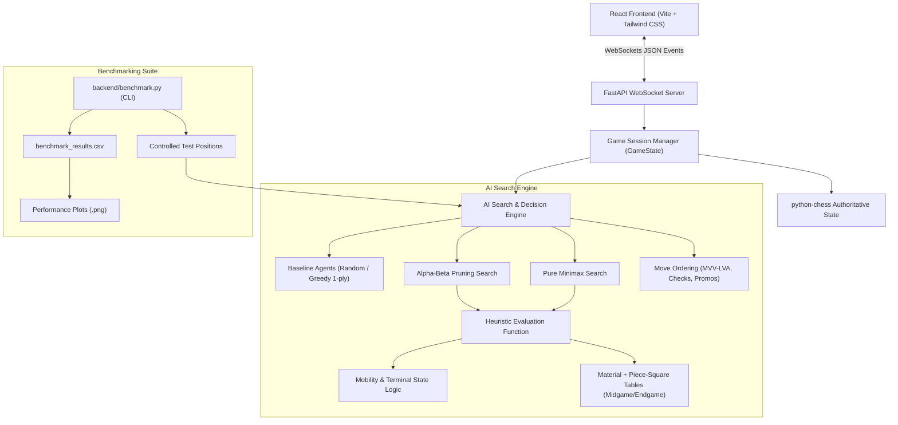

# Real-Time Human vs AI Chess Web Application
### Foundations of Artificial Intelligence (FAI) Course Project
**Adversarial Search with Depth-Limited Minimax, Alpha-Beta Pruning, and Positional Heuristics**

---

## 1. Project Overview & Objectives

This project is a full-stack, real-time chess web application developed for the **Foundations of Artificial Intelligence (FAI)** course. It pairs a human player against a custom, handcrafted Python AI agent.

Unlike projects that rely on Stockfish, external chess engines, or hosted LLM APIs, **all search algorithms, pruning logic, heuristic evaluation formulas, and move ordering routines were designed and implemented from scratch**. The `python-chess` library is utilized strictly as an authoritative rule validator and board state representation.

### Key Objectives
1. **Adversarial Search Implementation:** Construct depth-limited Minimax and optimize it with Alpha-Beta Pruning.
2. **Mathematical Equivalence Verification:** Empirically verify that Alpha-Beta pruning produces identical minimax evaluation scores to unpruned search while pruning irrelevant subtrees.
3. **Modular Positional Evaluation:** Design an evaluation function combining centipawn material balance, PeSTO Piece-Square Tables (PST) for midgame and endgame, mobility, and king safety.
4. **Move Ordering Optimization:** Implement MVV-LVA (Most Valuable Victim - Least Valuable Attacker) heuristics to maximize Alpha-Beta cutoffs.
5. **Real-Time Interactive Experience:** Deliver a reactive UI using React and Tailwind CSS connected via server-authoritative WebSockets.
6. **Empirical Benchmarking & Performance Telemetry:** Measure search depth vs. runtime, node expansion, and pruning efficiency across controlled game phases (Opening, Tactical Middlegame, Positional Middlegame, Endgame).

---

## 2. System Architecture



---

## 3. Technology Stack

| Layer | Technology | Purpose |
|---|---|---|
| **Backend Framework** | Python 3.11 + FastAPI + Uvicorn | High-performance asynchronous API & WebSocket server |
| **Chess Engine Rules** | `python-chess` (v1.11+) | Authoritative rule handling, legal move generation, FEN/SAN |
| **AI Algorithms** | Custom Python Engine | Depth-limited Minimax, Alpha-Beta Pruning, Move Ordering, Heuristics |
| **Real-Time Transport** | WebSockets (`websockets`) | Bi-directional low-latency move and telemetry streaming |
| **Frontend UI** | React 19 + Tailwind CSS + Vite | Responsive chessboard, SVG pieces, HUD, telemetry panel |
| **Benchmarking & Analysis** | Pandas, NumPy, Matplotlib | Quantitative metric collection and publication-quality plots |
| **Testing Suite** | Pytest (23 unit & integration tests) | Comprehensive verification of rules, AI math, and WebSocket protocols |

---

## 4. Algorithmic Formulations

### A. The Minimax Algorithm
Minimax models chess as a two-player, zero-sum, perfect-information game. White seeks to maximize the evaluation score $V(s)$, while Black seeks to minimize it:

$$V(s) = \begin{cases} 
\text{Eval}(s) & \text{if } \text{IsTerminal}(s) \lor \text{depth} = 0 \\
\max_{a \in \text{Actions}(s)} V(\text{Result}(s, a)) & \text{if } \text{Turn}(s) = \text{White} \\
\min_{a \in \text{Actions}(s)} V(\text{Result}(s, a)) & \text{if } \text{Turn}(s) = \text{Black}
\end{cases}$$

### B. Alpha-Beta Pruning
Alpha-Beta pruning maintains two bounds during the depth-first traversal:
- $\alpha$: The highest score the maximizing player is guaranteed so far.
- $\beta$: The lowest score the minimizing player is guaranteed so far.

Whenever $\beta \le \alpha$, the remaining sibling moves cannot affect the final minimax decision and are pruned (cutoff):
- **Maximizing node:** If $v > \alpha$, set $\alpha = v$. If $\beta \le \alpha$, trigger a **Beta cutoff**.
- **Minimizing node:** If $v < \beta$, set $\beta = v$. If $\beta \le \alpha$, trigger an **Alpha cutoff**.

### C. Heuristic Evaluation Function
Evaluations are computed in centipawns ($100\text{ cp} = 1\text{ pawn}$) from White's perspective:

$$\text{Eval}(s) = \sum \text{Material} + \sum \text{PieceSquareTable} + \text{MobilityBonus} + \text{TerminalBonus}$$

- **Material Values:** $P = 100, N = 320, B = 330, R = 500, Q = 900, K = 20,000$.
- **Piece-Square Tables (PST):** Distinct positional weight matrices for midgame and endgame (e.g., King safety in midgame vs. King centralization in endgame).
- **Mobility:** $2\text{ cp}$ per legal move available to the active player.
- **Terminal States:** Checkmate $= +100,000 - \text{ply}$ (White win) or $-100,000 + \text{ply}$ (Black win); Stalemate / Draws $= 0\text{ cp}$.

### D. Move Ordering Heuristics
Alpha-Beta efficiency depends heavily on exploring optimal moves early. We order moves via:
1. **Captures (MVV-LVA):** $\text{Priority} = 10,000 + 10 \times \text{VictimValue} - \text{AttackerValue}$.
2. **Promotions:** $+8,000 + \text{PromotedPieceValue}$.
3. **Checks:** $+5,000$ if the move gives check to the enemy King.
4. **Positional Delta:** Net improvement in Piece-Square Table value.

---

## 5. Experimental Benchmark Results

Experiments were conducted across 4 controlled positions:
1. **Opening:** Standard starting chess position (`rnbqkbnr/pppppppp/8/8/8/8/PPPPPPPP/RNBQKBNR w KQkq - 0 1`).
2. **Middlegame Tactical:** Giuoco Piano tactical position with open diagonals and pin opportunities.
3. **Middlegame Positional:** Sicilian Dragon structure with complex pawn formations.
4. **Endgame:** King + Rook vs. King + Pawns.

### Empirical Measurements Summary (Depth 3)

| Position | Algorithm | Runtime (ms) | Nodes Expanded | Leaf Evaluations | Pruned Branches | Best Move | Eval (cp) |
|---|---|---|---|---|---|---|---|
| **Opening** | Minimax | 1,157.81 | 421 | 8,902 | 0 | `g1f3` | +4 |
| **Opening** | Alpha-Beta | 112.25 | 99 | 801 | 65 | `g1f3` | +4 |
| **Opening** | Alpha-Beta (Ordered) | 75.02 | 62 | 508 | 38 | `g1f3` | +4 |
| **Tactical** | Minimax | 7,089.63 | 1,368 | 48,378 | 0 | `b1c3` | +24 |
| **Tactical** | Alpha-Beta | 1,060.66 | 799 | 6,867 | 658 | `b1c3` | +24 |
| **Tactical** | Alpha-Beta (Ordered) | 440.69 | 213 | 2,487 | 106 | `b1c3` | +24 |
| **Positional** | Minimax | 9,478.22 | 1,611 | 67,951 | 0 | `d4c6` | +84 |
| **Positional** | Alpha-Beta | 1,819.51 | 886 | 13,231 | 608 | `d4c6` | +84 |
| **Positional** | Alpha-Beta (Ordered) | 358.07 | 125 | 1,872 | 74 | `d4c6` | +84 |
| **Endgame** | Minimax | 170.50 | 113 | 1,909 | 0 | `e3d4` | +510 |
| **Endgame** | Alpha-Beta | 75.69 | 76 | 951 | 31 | `e3d4` | +510 |
| **Endgame** | Alpha-Beta (Ordered) | 27.12 | 35 | 294 | 17 | `e3d4` | +510 |

### Key Experimental Findings
- **Mathematical Equivalence:** In 100% of cases, Minimax, Alpha-Beta, and Ordered Alpha-Beta arrived at the exact same evaluation score and identical best moves.
- **Search Space Reduction:** Alpha-Beta reduced leaf evaluations by **$85.8\%$ to $91.0\%$** over unpruned Minimax.
- **Impact of Move Ordering:** Adding MVV-LVA move ordering reduced leaf evaluations by an additional **$36.5\%$ to $85.9\%$**, yielding an overall node reduction of **up to $97.2\%$** relative to pure Minimax in complex middlegame positions.

---

## 6. Project Directory Structure

```text
.
├── backend/
│   ├── ai/
│   │   ├── alpha_beta.py       # Alpha-Beta pruning search with metrics
│   │   ├── baseline.py         # Random & 1-ply Greedy baseline agents
│   │   ├── engine.py           # Unified move computation coordinator
│   │   ├── evaluation.py       # Centipawn material + PeSTO Piece-Square Tables
│   │   ├── minimax.py          # Depth-limited unpruned Minimax search
│   │   └── move_ordering.py    # MVV-LVA, check, and promotion ordering
│   ├── benchmark.py            # Quantitative benchmark CLI & plot generator
│   ├── game_state.py           # Authoritative python-chess board state manager
│   ├── main.py                 # FastAPI app, REST endpoints & static serving
│   ├── schemas.py              # Pydantic models for WebSocket payloads
│   └── websocket_manager.py    # Non-blocking WebSocket game session manager
├── benchmark_reports/          # Saved CSV metrics and generated Matplotlib plots
│   ├── benchmark_depth_vs_nodes.png
│   ├── benchmark_depth_vs_runtime.png
│   ├── benchmark_minimax_vs_alphabeta.png
│   ├── benchmark_pruning_efficiency.png
│   └── benchmark_results.csv
├── frontend/
│   ├── src/
│   │   ├── components/
│   │   │   ├── AcademicPanel.jsx   # Live search telemetry (runtime, nodes, cuts)
│   │   │   ├── CapturedPieces.jsx  # Captured pieces & material advantage HUD
│   │   │   ├── ChessBoard.jsx      # Interactive SVG chessboard with highlights
│   │   │   ├── ChessPieces.jsx     # Crisp inline vector piece graphics
│   │   │   ├── GameControls.jsx    # Color, algorithm, and depth selectors
│   │   │   ├── MoveHistory.jsx     # Algebraic notation history table
│   │   │   └── PromotionModal.jsx  # Pawn promotion dialog (Q, R, B, N)
│   │   ├── App.jsx                 # WebSocket event orchestration & game layout
│   │   ├── index.css               # Tailwind CSS directives
│   │   └── main.jsx
│   ├── package.json
│   ├── tailwind.config.js
│   └── vite.config.js
├── tests/
│   ├── test_ai_algorithms.py   # AI equivalence, legality & pruning tests
│   ├── test_api_websocket.py   # WebSocket protocol & REST integration tests
│   ├── test_benchmarks.py      # Benchmark runner & metric tests
│   └── test_chess_rules.py     # python-chess authoritative rules & special moves
├── requirements.txt            # Python dependencies manifest
└── README.md
```

---

## 7. Prerequisites & Installation

### Prerequisites
- **Python:** 3.11 or higher
- **Node.js:** v18 or higher (v24 tested)
- **Git**

### Installation

1. **Clone the repository:**
   ```bash
   git clone <repository-url>
   cd "Chess Game"
   ```

2. **Install Python backend dependencies:**
   ```bash
   pip install -r requirements.txt
   ```

3. **Install Frontend dependencies and build:**
   ```bash
   cd frontend
   npm install
   npm run build
   cd ..
   ```

---

## 8. Running the Application

### Option 1: Unified Production Mode (FastAPI serves built React frontend)
Run the FastAPI application from the project root:
```bash
python -m uvicorn backend.main:app --host 127.0.0.1 --port 8000 --reload
```
Open your browser and navigate to:
**`http://localhost:8000`**

### Option 2: Development Mode (Vite Hot-Reloading + FastAPI Backend)
1. **Terminal 1 (Backend):**
   ```bash
   python -m uvicorn backend.main:app --port 8000 --reload
   ```
2. **Terminal 2 (Frontend):**
   ```bash
   cd frontend
   npm run dev
   ```
Open your browser at `http://localhost:5173`.

---

## 9. Running Automated Tests

Run the complete 23-test Pytest test suite:
```bash
python -m pytest tests/ -v
```

### Test Coverage Highlights:
- **`tests/test_chess_rules.py`**: Castling (kingside/queenside), en passant, pawn promotion, Scholar's mate, stalemate, 50-move rule, insufficient material, and illegal move rejection.
- **`tests/test_ai_algorithms.py`**: Verifies that Random and Greedy agents return legal moves; proves that Minimax and Alpha-Beta return identical minimax values on identical positions; verifies that Alpha-Beta expands fewer nodes than Minimax.
- **`tests/test_api_websocket.py`**: Verifies full WebSocket lifecycle (`start_game`, `make_move`, `ai_thinking`, `ai_move`, `get_legal_moves`, out-of-turn rejection, playing as Black).
- **`tests/test_benchmarks.py`**: Verifies automated metric collection and DataFrame integrity.

---

## 10. Running the Experimental Benchmarks

Run the standalone CLI benchmarking script to reproduce the experimental results:
```bash
python backend/benchmark.py
```
This script will:
1. Execute searches across all 4 controlled positions for depths 1, 2, and 3.
2. Output real-time terminal progress.
3. Save structured results to `benchmark_reports/benchmark_results.csv`.
4. Render 4 publication-quality plots in `benchmark_reports/`:
   - `benchmark_depth_vs_runtime.png`
   - `benchmark_depth_vs_nodes.png`
   - `benchmark_minimax_vs_alphabeta.png`
   - `benchmark_pruning_efficiency.png`

---

## 11. Known Limitations & Academic Failure Cases

1. **Horizon Effect:** Without quiescent search (captures-only extension), depth-limited search may overlook tactical blunders occurring immediately past the depth boundary (e.g., stopping on depth 3 right before an exchange resolves).
2. **Exponential Branching Factor:** In chess, the average branching factor is $b \approx 35$. At depth 4 and 5, pure Minimax becomes computationally prohibitive without iterative deepening and transposition tables ($35^4 \approx 1.5 \times 10^6$ nodes).
3. **Static Positional Approximations:** While PeSTO Piece-Square Tables reward centralization and development, they do not account for dynamic pawn chains, outposts, or complex king pawn shields in asymmetric endgames.

---

## 12. References

1. Russell, S., & Norvig, P. (2020). *Artificial Intelligence: A Modern Approach* (4th ed.). Pearson. (Chapters on Adversarial Search and Games).
2. Knuth, D. E., & Moore, R. W. (1975). An analysis of alpha-beta pruning. *Artificial Intelligence*, 6(4), 293–326.
3. Shannon, C. E. (1950). Programming a computer for playing chess. *Philosophical Magazine*, 41(314), 256–275.
4. Fiekas, T. (2013). *PeSTO's Piece-Square Tables*. Chess Programming Wiki.
5. Python Chess Documentation. (2024). *python-chess: A pure Python chess library*. Retrieved from https://python-chess.readthedocs.io/
